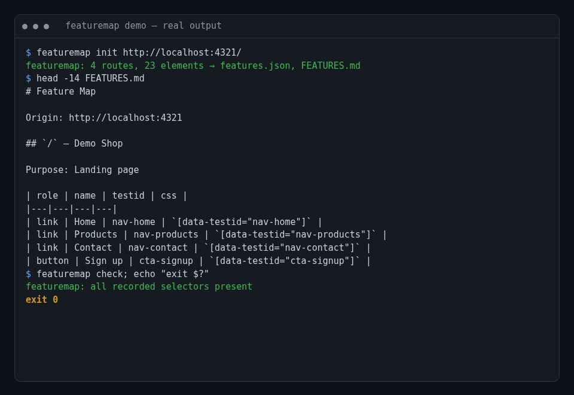
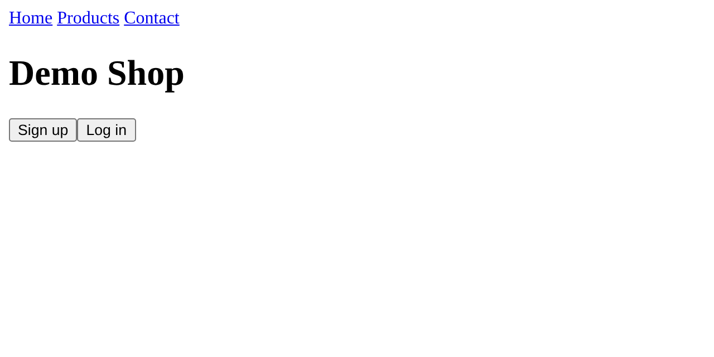
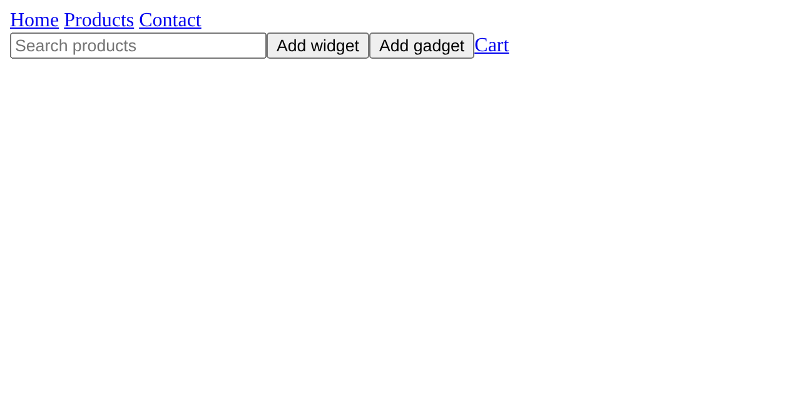

# featuremap

Generate a machine-readable map of an app's features (route → selectors → purpose) so agents can drive and verify the app.


## The pain

Coding agents working on a web app keep rediscovering the same UI: which routes exist, which buttons matter, what selector reaches them. They guess, click the wrong thing, and "verify" against stale assumptions. A checked-in feature map gives the agent (and you) a shared, diffable source of truth, and `featuremap check` tells you when the UI drifted away from it.

## See it

Real output from running against the bundled demo site (`pnpm demo`): `init` found 4 routes / 23 elements, `check` exited 0.



| Demo home (`/`) | Demo products (`/products`) |
|---|---|
|  |  |

## Quickstart

```bash
pnpm add -D featuremap        # or: npx featuremap ...
npx playwright install chromium

featuremap init http://localhost:3000   # crawl same-origin (BFS, max 30 pages) → features.json + FEATURES.md
featuremap check                        # exit 0 if every recorded selector still exists, 1 otherwise
```

Try it on the bundled demo:

```bash
pnpm install && pnpm demo &              # http://localhost:4321/
node bin/featuremap.js init http://localhost:4321/
node bin/featuremap.js check
```

Each route records `route`, `url`, `title`, `purpose` (meta description or title) and clickable elements with `role`, `name`, `testid`, and a `css` selector (preferring `data-testid`, then `id`).

## Inspiration

The idea of giving agents a "feature map" of an app before letting them work in parallel comes from Lauren Tan's (poteto) Control Glass work, as discussed here: <https://redreamality.com/blog/lauren-tan-poteto-trust-before-parallel/>. This project is an independent, minimal take on that idea.

## License

MIT
